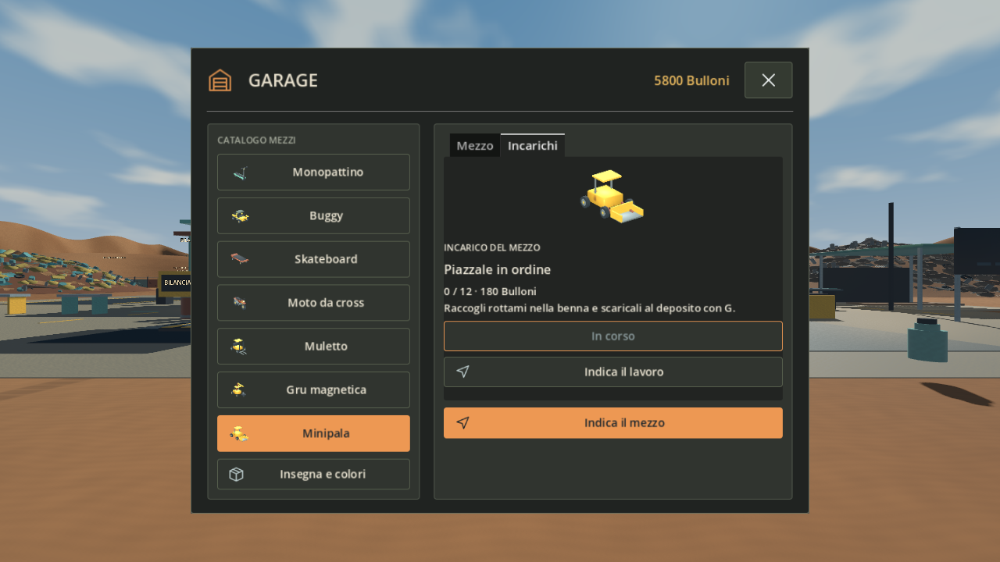
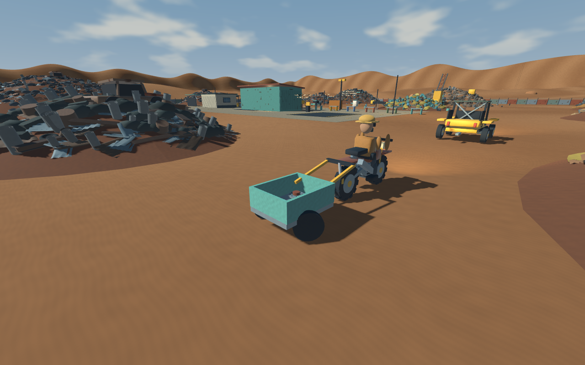

# Scrap Empire — Demo v2

Scrap Empire is a first-person single-player scrapyard simulator for players who enjoy salvaging, crafting and growing a recycling business in an explorable desert. Collect and dismantle scrap, sell materials, build useful products and upgrade your equipment; v2 adds industrial vehicle jobs, working buggy and dirt-bike trailers, clearer menus and English/Italian language options.

**[Download the Windows v2 ZIP](https://github.com/GIUSEPPE201026/scrap-empire/releases/download/v0.2.0/ScrapEmpire-v2-Windows-x86_64.zip)** · [Release notes](https://github.com/GIUSEPPE201026/scrap-empire/releases/tag/v0.2.0)



## Play

Extract the entire ZIP and run **ScrapEmpire.exe**. Keep **ScrapEmpire.pck** beside it. No Godot installation, server or account is required. Windows x86-64 and an OpenGL 3.3-compatible GPU are required. The game opens in a window; fullscreen is optional. This is an unsigned development demo.

For English, choose **Impostazioni → Grafica → Lingua / Language → English → Applica**. The language choice is saved and is also available from pause settings. Choose **GIOCA / PLAY** to enter your scrapyard.

## What to test

1. Hold left mouse to collect nearby scrap with the correct tool. Your starting bag holds **20 kg**.
2. Press E at the scale. **Deposit** keeps materials in storage; **Sell surplus** earns Bolts. These are separate actions.
3. Buy an upgrade at the office terminal, craft at the garage bench, and continue with saved progression. J shows the next objective; M sets a waypoint.
4. Unlock the plots and buy industrial vehicles in the garage. Open a vehicle's **Jobs** tab, accept a job and track the work. The crane deposits ferrous parts, the loader deposits loose scrap, and the forklift ships bales on pallets. Each has three progressive jobs, with rewards claimed separately.
5. Build and place a cart. Align its drawbar with the rear hitch of a buggy or bike and press E at the hitch. Board at the seat; E gets out while keeping the trailer attached. H while stopped unhitches it. Buggy limit: **60 kg**; dirt-bike limit: **20 kg**.

The download includes no developer saves or currency grants. Progress is saved locally by Godot under the ScrapEmpire user-data directory. Keep a backup of existing saves before testing a development build.

## Controls

| Action | Default control |
| --- | --- |
| Move / look | WASD / mouse |
| Sprint / jump on foot | Shift / Space |
| Collect or dismantle | Hold left mouse within 3 m |
| Interact with aimed object, station, seat or hitch | E |
| Drag loose scrap | Hold right mouse |
| Equipment / journal / map | I / J / M |
| Tools | 1–3, 5–6 |
| Equip or stow scooter/skateboard | 4 |
| Whole-part recovery mode | R |
| Scanner / work light | F / L |
| Pause / close menu | Esc |
| Vehicle throttle, brake/reverse, steer | W / S / A-D |
| Parking brake / vehicle camera | P / V |
| Buggy handbrake drift | Space + steer |
| Bike rear brake / wheelie | Ctrl / Shift |
| Scooter jump, skateboard ollie, bike hop | Space |
| Industrial pickup/release | G |
| Raise/lower industrial attachment | Left/right mouse |
| Forklift pallet terminal / mini-loader debris push | H |
| Unhitch buggy/bike trailer while stopped | H |
| Placement preview | E or left click confirm; wheel/R rotate; right click/Esc cancel |



## Source and engine

Import **ScrapEmpire/project.godot** into **Godot 4.3 stable**, then press F5. The scenes, scripts, assets, data and tests are included. Game version is **0.2.0**, labeled Demo v2; the engine has not been upgraded. Matching Godot 4.3 export templates are required to export the Windows Desktop preset.

```sh
godot --headless --path ScrapEmpire --editor --import
# Create dist/windows first.
godot --headless --path ScrapEmpire --export-release "Windows Desktop" ../dist/windows/ScrapEmpire.exe
```

The explicit QA scene is `ScrapEmpire/scenes/review_export_smoke.tscn`; normal startup never runs it. Focused development tests are under `ScrapEmpire/tests`.

## v2 validation and limitations

See [validation](docs/VALIDATION_V2.md) and [changelog](CHANGELOG.md). The release is checked using a fresh source import, Windows export and tests of the actual exported executable. Automated scene tests and inspected screenshots do not replace a complete manual playthrough or guarantee compatibility with every PC.

Vehicle and trailer handling are assisted/arcade. Terrain is not deformable. Multiplayer code is retained as experimental, with development and verification deferred; the demo is focused on single player.

## Development and credits

This is an AI-assisted game in active development. Most development happened locally before the repository was first published. The commits here record publication snapshots and current release work, rather than a reconstructed history of the earlier local sessions.

Original game code and procedural art are published for review. Third-party notices are retained under `ScrapEmpire/third_party`; the Windows ZIP includes Godot and KidsCanCode license notices. See [THIRD_PARTY_NOTICES.md](THIRD_PARTY_NOTICES.md).
